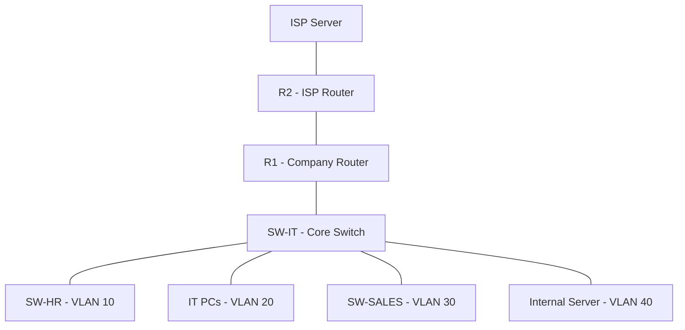

# Enterprise Network Design & Troubleshooting

## Overview

This project demonstrates the design and configuration of a simulated enterprise network using Cisco Packet Tracer.

The network is designed for a small organization with three departments: Human Resources (HR), IT, and Sales, along with a dedicated server network and a simulated ISP connection.

The project focuses on routing, switching, network segmentation, security, and troubleshooting.

## Technologies Used

- VLANs and Network Segmentation
- 802.1Q Trunking
- Inter-VLAN Routing (Router-on-a-Stick)
- DHCP Configuration
- OSPF Dynamic Routing
- NAT/PAT (Overload)
- Standard and Extended ACLs
- SSH Remote Management
- Network Connectivity Testing
- Network Troubleshooting

## Network Infrastructure

The network design includes:

- 2 Cisco 2911 Routers
- 3 Cisco 2960 Switches
- 6 Client PCs
- 1 Internal Server
- 1 Simulated ISP Server

## Network Topology



## IP Addressing Scheme

| Department | VLAN ID | Network | Default Gateway |
|------------|---------|---------|-----------------|
| HR | 10 | 192.168.10.0/24 | 192.168.10.1 |
| IT | 20 | 192.168.20.0/24 | 192.168.20.1 |
| Sales | 30 | 192.168.30.0/24 | 192.168.30.1 |
| Servers | 40 | 192.168.40.0/24 | 192.168.40.1 |

### Additional Networks

| Connection | Network |
|------------|---------|
| R1 - R2 | 10.0.0.0/30 |
| Simulated ISP Network | 198.51.100.0/24 |

## Network Configuration

### 1. VLAN Configuration

VLANs are used to logically separate departments into different broadcast domains.

Each department operates in its own VLAN to improve network organization and traffic segmentation.

### 2. Trunk Configuration

802.1Q trunk links are configured between switches and the router to transport traffic from multiple VLANs.

### 3. Inter-VLAN Routing

Router-on-a-Stick is implemented using router subinterfaces to enable communication between different VLANs.

### 4. DHCP Configuration

DHCP pools are configured on R1 to provide automatic IP address allocation to client devices.

Each VLAN has a separate DHCP pool with its corresponding default gateway.

### 5. OSPF Dynamic Routing

OSPF Area 0 is used to exchange routing information between R1 and R2.

The routers advertise their connected networks and establish an OSPF neighbor relationship.

### 6. NAT/PAT Configuration

PAT (Port Address Translation) is configured on R1 to translate internal private IP addresses using the router's outside interface.

The simulated external network is used to test address translation.

### 7. Network Security

Access Control Lists (ACLs) are designed to enforce network security policies.

Security policies include:

- Restricting HR access to the IT network.
- Allowing Sales HTTP access to the internal server.
- Blocking unauthorized Sales traffic to the internal server.
- Restricting SSH router management to the IT subnet.

## Troubleshooting Scenarios

The project includes five practical troubleshooting exercises:

1. VLAN Misconfiguration
2. DHCP Service Failure
3. OSPF Neighbor Failure
4. NAT/PAT Misconfiguration
5. ACL Blocking Legitimate Traffic

Each scenario focuses on identifying the problem, determining the root cause, applying corrective configurations, and verifying connectivity.

## Network Verification Commands

The following Cisco IOS commands are used for troubleshooting and verification:

```cisco
show ip interface brief
show ip route
show ip ospf neighbor
show vlan brief
show interfaces trunk
show ip dhcp binding
show ip nat translations
show ip nat statistics
show ip access-lists
show running-config
```

Additional connectivity testing includes:

```text
ping
tracert
traceroute
ssh
```

## Project Structure

```text
Enterprise-Network-Project/
|
|-- README.md
|-- .gitignore
|
|-- packet-tracer/
|   |-- Enterprise_Network.pkt
|
|-- configurations/
|   |-- R1.txt
|   |-- R2.txt
|   |-- SW-IT.txt
|   |-- SW-HR.txt
|   |-- SW-SALES.txt
|
|-- troubleshooting/
    |-- incident-reports.md
```

## How to Use

1. Download the Packet Tracer project file.
2. Open it using Cisco Packet Tracer.
3. Review the network topology and device configurations.
4. Test VLAN connectivity and inter-VLAN routing.
5. Verify DHCP, OSPF, and NAT/PAT configurations.
6. Test the configured security policies.
7. Review the troubleshooting scenarios and incident reports.

## Verification Status

The repository contains the Cisco Packet Tracer project and configuration references.

The documented network design and expected results should be compared with the actual device configurations and connectivity tests.

## Skills Demonstrated

- Enterprise Network Design
- Routing and Switching
- Network Segmentation
- Dynamic Routing Protocols
- Network Address Translation
- Access Control Lists
- Network Security Fundamentals
- Network Troubleshooting
- Cisco IOS CLI

## Author

**Gagik Zakoyan**

Information Security Student  
Yerevan State University

Interested in Network Engineering, NOC Operations and Cybersecurity.